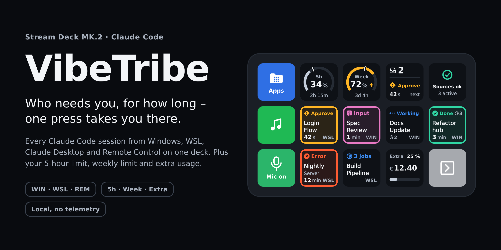
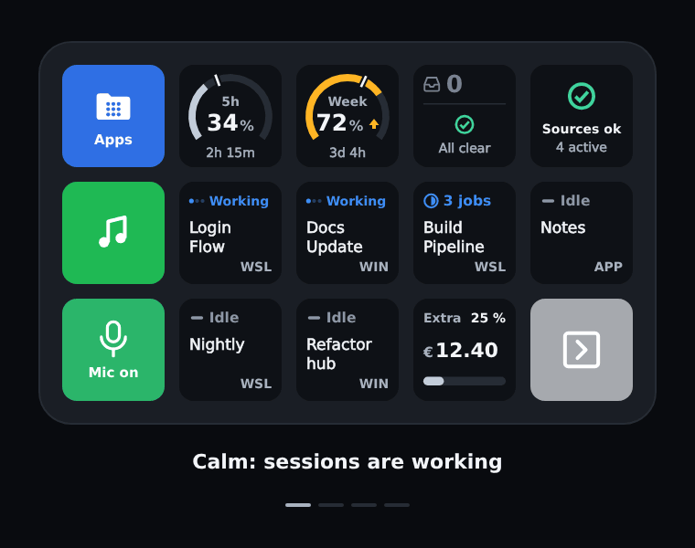
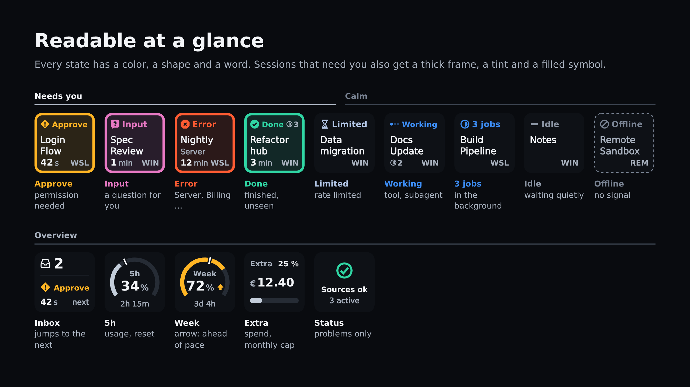
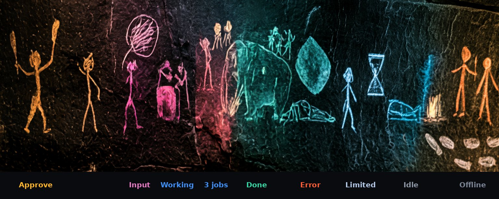
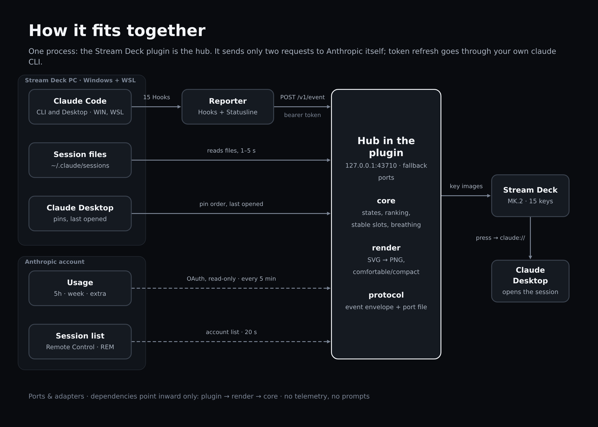

<p align="center">
  
</p>

<p align="center">
  <b>Who needs you, for how long – one press takes you there.</b><br>
  A Stream Deck plugin for all your Claude Code sessions, plus your 5-hour limit, weekly limit and extra usage.
</p>

<p align="center">
  <a href="https://github.com/h-mergel/vibetribe/actions/workflows/ci.yml"></a>
  
  
  
  
  
</p>

---

<p align="center">
  
</p>

## Why

Run a few Claude Code sessions in parallel and you quickly lose track: which one is waiting for approval? Which one is done? Which one has been stuck on a question for ten minutes? VibeTribe puts the answer on the keys of an **Elgato Stream Deck MK.2**. Every tile shows **state, waiting time and origin** – and one press opens the session in Claude Desktop.

- **Every source on one deck:** Windows, WSL, the Code tab in Claude Desktop, and Remote Control sessions on other machines.
- **Calm until you're needed:** only sessions that need you get a thick frame and a tint. A new request breathes for its first 30 s, then pulses briefly once a minute – never more than two keys at once.
- **One press takes you there:** press a slot to open its session in Claude Desktop; the inbox key cycles through everything that's waiting. Opening a session in Claude Desktop yourself counts as seen too.
- **Your pins first:** sessions pinned in Claude Desktop's sidebar keep their keys (switchable).
- **Limits at a glance:** 5-hour and weekly limits with a pace marker, extra usage against your monthly cap.
- **Local:** the plugin is its own hub. No telemetry, no prompts, no separate service.

## The tiles

<p align="center">
  
</p>

Every state is **triple-coded** – color, a distinct shape and a word – so it works without color vision too. A filled symbol means *unseen*, an outline means *seen*; once you've seen a session, only a thin frame remains.

| State | Meaning | Behavior |
|---|---|---|
| **Approve** | permission needed | thick frame, breathes for 30 s, then reminders |
| **Input** | Claude has a question | thick frame, breathes for 30 s, then reminders |
| **Error** | `Server`, `Billing`, `Rate limit`, `Overloaded` | thick frame, never breathes |
| **Done** | finished, not yet seen | thick frame, never breathes |
| **Limited** | rate limited / overloaded | calm |
| **Working** | a tool or subagent is running | moving dot |
| **n jobs** | background jobs (shell, subagent) | calm, survives a plugin restart |
| **Idle** | waiting quietly | calm |
| **Offline** | remote session without a signal (90 s) | dashed, removed after 210 s |

The origin is always in the bottom right: `WIN`, `WSL` or `REM`. Waiting time reads `42 s`, `3 min`, `1:05 h`, `12 h`.

### Meet the tribe

Every tribe needs someone who keeps an eye on the fire.

<p align="center">
  
</p>

<sub>Approve: “May I hit it?” · Input: “Ugh?” · Working: bang, bang, bang · Done: mammoth acquired · Error: boulder · Limited: fire's out, wait · Idle: zzz · Offline: gone hunting.</sub>

## Layout and keys

VibeTribe ships six actions (category "VibeTribe"). You decide where they go – the plugin adapts to whatever keys you place. A suggestion for page 1:

```
Apps    │ 5h     │ Week   │ Inbox  │ Status
Extra   │ Slot 1 │ Slot 2 │ Slot 3 │ Slot 4
Page 2  │ Slot 5 │ Slot 6 │ Slot 7 │ Slot 8
```

| Key | Short press | Long press (≥ 600 ms) |
|---|---|---|
| **Slot** | open the session in Claude Desktop | mark as seen |
| **Inbox** | jump to the most urgent session, again within 5 s for the next (`2/3`) | acknowledge all `Done` |
| **5h / Week** | refresh the limit (at most every 120 s) | – |
| **Extra** | open `claude.ai/settings/usage` | – |
| **Status** | show all four sources for 5 s | open the debug page |

Slots are stable: a session keeps its slot for as long as it lives. Sessions that need attention push calm ones out of the slots; anything that doesn't fit is counted on the inbox as `+N`. Add as many slot keys as you like – the plugin uses every one you place.

**Pinned sessions:** with *Prefer pinned sessions* on (click a slot key in the Stream Deck app; the checkbox is in its settings, on by default), sessions pinned in Claude Desktop's sidebar win a slot over unpinned ones in the same state, and alarms push out unpinned sessions first. A running session still beats a pinned one that is idle.

## How it fits together

<p align="center">
  
</p>

A small **reporter** hooks into Claude Code via hooks and a statusline passthrough and reports events to the **hub**, which runs inside the plugin process on `127.0.0.1:43710` – or, if that port is taken, on the first free one of `37710`, `31710`, `25710`; the port it uses is written to `%USERPROFILE%\.vibetribe\port`, where the reporters read it. The hub also reads the session files, Claude Desktop's pins and when you last opened a session there, and asks Anthropic for usage and the list of remote sessions. The pure domain (`core`) decides states, ranking and slots; `render` draws the tiles.

| Package | Job |
|---|---|
| `core` | pure domain, no I/O: states, ranking, slots, breathing |
| `render` | tiles as SVG/PNG, variants `comfortable` and `compact` |
| `protocol` | the shared contracts: event envelope v1 and the port file |
| `reporter` | hook and statusline roles, `setup` for installation |
| `hub` | the hub: ingress, session sources, usage, remote |
| `plugin` | Stream Deck adapter, jump, composition root |

Architecture: ports & adapters, dependencies point inward only (`plugin → render → core`). Decisions are recorded in [`docs/adr/`](docs/adr/).

## Requirements

- Windows 10 or later (tested on Windows 11), optionally WSL2 (Ubuntu)
- Stream Deck app 7.1 or later (tested with 7.6) and a **Stream Deck MK.2**
- Node.js ≥ 24 and pnpm 10.33
- Claude Code and/or Claude Desktop, signed in, with `claude.exe` on your `PATH`

> [!NOTE]
> Linux and macOS are not supported. Remote sessions from other machines still show up – through your account's session list.

## Install from source

There is no release package or Marketplace listing yet. Run every command in WSL, inside the repo.

> [!WARNING]
> Every step changes your real machine (`settings.json`, Stream Deck plugins, profiles). Run them deliberately.

**1. Dependencies**

```bash
pnpm install
```

**2. Install hooks and statusline** – Windows first, then WSL:

```bash
pnpm reporter:build

# Windows (UNC path into the repo)
node \\wsl.localhost\Ubuntu\home\<user>\…\vibetribe\packages\reporter\dist\reporter.mjs setup

# WSL (reuses the Windows token)
node packages/reporter/dist/reporter.mjs setup [--windows-home /mnt/c/Users/<name>]
```

`setup` adds 15 hook events and a statusline passthrough to `~/.claude/settings.json` – with a backup, atomically and idempotently. Other entries and an existing statusline are kept.

**3. Build and deploy the plugin**

```bash
pnpm plugin:deploy
```

**4. Quit the Stream Deck app completely and start it again.**

**5. Place the keys** – drag the actions onto keys, or:

```bash
pnpm profile:layout show  <ProfilesV3>
pnpm profile:layout apply <ProfilesV3> <layout.json> [--write]
```

Without `--write` you only get a preview. `--write` refuses while `StreamDeck.exe` is running, backs up both manifests and moves other keys to page 2.

<details>
<summary><b>Uninstall</b></summary>

- **Hooks:** `node …\reporter.mjs setup --uninstall` (per host) removes only VibeTribe's own entries and restores your previous statusline.
- **Plugin:** with the app closed, delete `%APPDATA%\Elgato\StreamDeck\Plugins\dev.h2k.vibetribe.sdPlugin`; optionally `%USERPROFILE%\.vibetribe` and `%APPDATA%\vibetribe`.
- **Profile layout:** restore from the `.bak` files or your own backup.

</details>

## Settings

Environment variables only take effect after a full restart of the Stream Deck app (e.g. `setx VIBETRIBE_VARIANT compact`).

| Variable | Default | Meaning |
|---|---|---|
| `VIBETRIBE_VARIANT` | `comfortable` | `comfortable` (larger type) or `compact` (more detail) |
| `VIBETRIBE_MAX_FRAMES` | `10` | frames per second for the whole plugin (1–100) |
| `VIBETRIBE_PORT` | `43710` | first hub port; if it is taken, the hub falls back to `37710`, `31710`, `25710` |
| `VIBETRIBE_WSL_DISTRO` | `Ubuntu` | WSL distribution |
| `VIBETRIBE_WSL_USER` | detected | WSL user |

*Prefer pinned sessions* is a checkbox in the settings of the session slot action in the Stream Deck app; it applies to all slots at once and takes effect immediately.

Logs live in `%APPDATA%\vibetribe\logs\` (rotated, never containing tokens).

## Privacy and security

<table>
<tr>
<td width="50%" valign="top">

**What is read**

- Hook events: event name, time, tool name, session id, working directory – **never prompt text**
- Statusline: only the limit values
- Session files of live processes
- Claude Desktop: the order of pinned sessions from its config, and when you last opened a waiting session (`lastFocusedAt`) – nothing else from those files
- The OAuth token, read-only – VibeTribe never refreshes it itself

</td>
<td width="50%" valign="top">

**What leaves the machine**

- `GET /api/oauth/usage` – every 5 min
- `GET /v1/code/sessions` – every 20 s
- both over HTTPS to `api.anthropic.com`, no redirects
- token refresh: when the token has expired, at most once an hour, your own `claude` CLI runs `claude -p /cost` (no model call) and renews its credentials
- only when you run them: `pnpm drift` makes one GET to each of the two endpoints; `pnpm e2e:live --spend-tokens` starts one short Claude session on Haiku (capped at $0.05)
- nothing else: no telemetry, no prompts, no content

</td>
</tr>
</table>

The hub listens on `127.0.0.1` only, rejects browser requests and requires a bearer token for write endpoints (32 random bytes, readable by the owner only). Hooks fail open: they never make Claude Code fail – the reporter gives up after 300 ms (hook timeout 2 s).

## Limitations

- Windows only (with optional WSL); no release package, install from source.
- Usage, the session list and Claude Desktop's own files are **undocumented** and may break at any time (Claude Desktop already moved its data folder once). The deck shows outages calmly as `As of 14:32`, `Sign in` or `Offline`; the hub checks its local assumptions every hour and logs a `drift:` line when one breaks. After updates of Claude Desktop, Claude Code, Windows or WSL, run `pnpm drift`.
- Remote sessions are coarser: no tool name, no background jobs, no distinction between approval and question, up to 20 s delay. Once you have read a remote turn, it no longer counts as waiting – unless Claude is still running.
- Pins only work for sessions in Claude Desktop's Code tab; pinned remote or cloud sessions are not read.
- A session that is already open in Claude Desktop when it finishes stays `Done` until you jump to it from the deck or click another session and back.
- `Done` of local sessions is lost on a plugin restart (remote `Done` comes back, because the remote list reports unread sessions); background jobs are kept.
- Non-Latin titles (e.g. Japanese) are missing from the tile font.

## Troubleshooting

| You see | What it means | What to do |
|---|---|---|
| The VibeTribe actions don't appear | The Stream Deck app hasn't loaded the plugin | Quit the app completely (tray icon too) and start it again – `streamdeck://plugins/restart/…` doesn't work outside developer mode |
| `Port in use` on the status key | None of the four ports (43710, 37710, 31710, 25710) is free – e.g. WSL's mirrored networking reserves a moving block of ports, or a standalone `hub.mjs` runs | The plugin retries every 5 s on its own. `pnpm drift` shows which ports are blocked; stop the other process if there is one |
| Pins or "opened in Claude Desktop" stopped working | Claude Desktop changed its files with an update | Run `pnpm drift`; a `changed:` line names what moved |
| `No token` on the status key | The reporter token is missing | Run `reporter.mjs setup` on Windows first, then in WSL |
| `Sign in` on the limit keys | The Claude login is missing or expired | Sign in to Claude Code; make sure `where.exe claude` finds the CLI so the token can be refreshed |
| `As of 14:32` | The last usage data is older than 15 min | Usually temporary; short-press the key to refresh (at most every 120 s) |
| A slot shows `No link` | The session has no deep link (e.g. CLI in a terminal) | Expected – only sessions Claude Desktop knows can be opened |
| Sessions from WSL are missing | The status key shows `WSL` as stale or down | Check `VIBETRIBE_WSL_DISTRO` / `VIBETRIBE_WSL_USER`, and that `setup` ran inside WSL |

Hold the status key to open the debug page at `http://127.0.0.1:<port>/debug` (the port is in `%USERPROFILE%\.vibetribe\port`, usually `43710`); logs are in `%APPDATA%\vibetribe\logs\`.

## Roadmap

- [ ] Release package via `streamdeck pack` instead of deploy-by-copy
- [ ] Stream Deck Marketplace listing
- [ ] Optional agent for macOS machines

## Development

```bash
pnpm check            # Biome + strict TypeScript + vitest (same as CI)
pnpm gallery          # PNG gallery of every tile in out/gallery/
pnpm plugin:headless  # hub + deck without a Stream Deck (port 43799)
pnpm hub:simulate packages/hub/fixtures/scenarios/five-waiting.jsonl
pnpm deck:render <scenario> --after <ms> [--variant compact]
pnpm drift            # read-only check of every undocumented interface on this machine
pnpm e2e:live --spend-tokens  # one real Claude turn on Haiku against the running hub (opt-in)
```

In headless mode you press keys via stdin (`press mk2:1:0`, `long mk2:1:0`); a mirror of the deck is at `/debug/keys`. More: [spec](docs/superpowers/specs/2026-10-10-vibetribe-design.md) · [ADRs](docs/adr/) · [design handoff](docs/design/handoff-2026-10-13/HANDOFF.md).

Work is test-driven with Conventional Commits; `pnpm check` must pass before every commit.

<p align="center">
  
</p>

<p align="center"><sub>Ancient technology. Still the best way to know who needs you.</sub></p>

## Acknowledgements

Designed and built together with [Claude Code](https://claude.com/claude-code).

## License

[MIT](LICENSE)

<sub>VibeTribe is an independent project and is not affiliated with, endorsed or sponsored by Anthropic or Elgato. Claude and Claude Code are trademarks of Anthropic; Stream Deck is a trademark of Corsair Memory, Inc.</sub>
